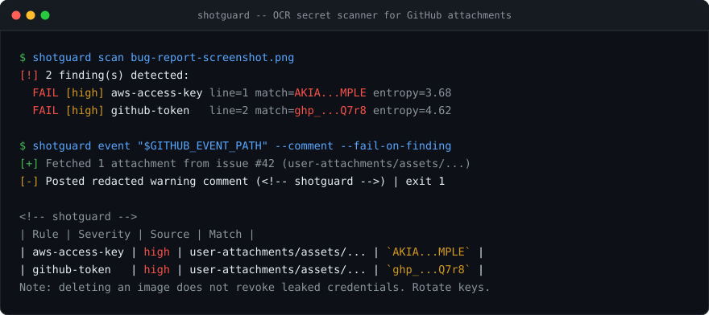

<h1 align="center">shotguard</h1>

<p align="center">
  <strong>OCR secret scanner for images, GIFs, and videos attached to GitHub Issues and Pull Requests.</strong><br>
  Python 3.11+ standard library only &middot; local <code>tesseract</code> OCR &middot; optional <code>ffmpeg</code> frame sampling
</p>

<p align="center">
  <a href="https://github.com/Hinikaa/shotguard/actions/workflows/ci.yml"></a>
  
  
  <a href="LICENSE"></a>
</p>

<p align="center">
  
</p>

---

## Why

Text scanners such as Gitleaks and TruffleHog inspect git history and markdown text, not screenshots or screen recordings pasted into `github.com/user-attachments/assets/...`. `shotguard` extracts media URLs from issue, PR, and comment bodies, downloads them locally within an SSRF-safe host allowlist and size cap, runs `tesseract` OCR (and `ffmpeg` keyframe sampling for GIF/video), and flags redacted matches before keys sit in public threads.

## Installation

System prerequisites:

```bash
# Debian / Ubuntu
sudo apt-get install -y tesseract-ocr ffmpeg

# macOS
brew install tesseract ffmpeg
```

Install from source or run directly from a checkout:

```bash
pip install .
python3 -m shotguard --help
```

## Quick Start

Scan local images, directories, or recordings:

```bash
shotguard scan screenshot.png
shotguard scan docs/images/ --format sarif
shotguard scan recording.gif --max-frames 10 --format json
```

Scan media attachments from a GitHub Actions event payload:

```bash
shotguard event "$GITHUB_EVENT_PATH" --comment --sarif results.sarif
```

Run the included self-contained demo (generates a temporary synthetic PNG and scans it with `tesseract`):

```bash
./demo/run-demo.sh
```

Exit codes: `0` clean (or `--no-fail-on-finding` in `event` mode), `1` findings detected, `2` usage or runtime error.

## GitHub Action Usage

```yaml
name: Secret Scan Attachments

on:
  issues:
    types: [opened, edited]
  pull_request:
    types: [opened, edited]
  issue_comment:
    types: [created, edited]

permissions:
  issues: write
  pull-requests: write
  contents: read

jobs:
  shotguard:
    runs-on: ubuntu-latest
    steps:
      - uses: Hinikaa/shotguard@v1
        with:
          github-token: ${{ secrets.GITHUB_TOKEN }}
          comment: "true"
          fail-on-finding: "true"
```

### Action Inputs

| Input | Default | Description |
| :--- | :--- | :--- |
| `github-token` | `${{ github.token }}` | Token for downloading private attachments and posting comments |
| `comment` | `"true"` | Post or update a redacted `<!-- shotguard -->` summary comment on findings |
| `fail-on-finding` | `"true"` | Fail the workflow step when findings are detected |
| `rules` | `""` | Optional path to a custom JSON or TOML rules file |
| `allow-any-host` | `"false"` | Allow non-GitHub HTTPS attachment URLs (private IPs remain blocked) |
| `max-frames` | `"10"` | Maximum frames sampled from GIF/video attachments |
| `max-bytes` | `"15728640"` | Maximum download size per attachment in bytes (15 MiB) |
| `sarif-file` | `""` | Optional path to write SARIF 2.1.0 output |
| `scan-repo-images` | `"false"` | Also scan checked-in image files in the repository workspace |
| `scan-video` | `"false"` | Install `ffmpeg` if missing and scan GIF/video files |

### Action Outputs

| Output | Description |
| :--- | :--- |
| `findings-count` | Total number of findings detected |
| `report-path` | Path to the generated JSON report |

## CLI Reference

### `shotguard scan`

| Flag | Default | Description |
| :--- | :--- | :--- |
| `paths` | required | One or more files or directories to scan |
| `--rules` | none | Path to custom JSON or TOML rules file |
| `--format` | `text` | Output format: `text`, `json`, or `sarif` |
| `--max-frames` | `10` | Maximum frames sampled from GIF/video files |
| `--lang` | `eng` | Tesseract language code |
| `--scan-video` | `false` | Include `.gif`, `.mp4`, `.webm`, and `.mov` when walking directories |

### `shotguard event`

| Flag | Default | Description |
| :--- | :--- | :--- |
| `event_json` | required | Path to GitHub Actions event JSON file |
| `--rules` | none | Path to custom JSON or TOML rules file |
| `--comment` / `--no-comment` | `--no-comment` | Post or update a `<!-- shotguard -->` PR/issue comment |
| `--fail-on-finding` / `--no-fail-on-finding` | `--fail-on-finding` | Return exit code `1` when findings exist |
| `--allow-any-host` | `false` | Allow HTTPS URLs outside GitHub asset hosts (private IPs still blocked) |
| `--max-frames` | `10` | Maximum frames sampled per GIF/video attachment |
| `--max-bytes` | `15728640` | Maximum download size per attachment in bytes |
| `--lang` | `eng` | Tesseract language code |
| `--scan-video` / `--no-scan-video` | `--no-scan-video` | Scan GIF/video attachments with `ffmpeg` |
| `--sarif` | none | Write SARIF 2.1.0 report to path |
| `--output-json` | none | Write redacted JSON report to path |
| `--token` | `$GITHUB_TOKEN` | GitHub token for private attachment downloads and comments |
| `--api-base` | `https://api.github.com` | GitHub REST API base URL |

## Custom Rules

Extend or override built-in rules by passing `--rules` with a `.toml` or `.json` file (see [rules/example-custom.toml](rules/example-custom.toml)). Matching an existing rule `id` replaces it.

```toml
[[rules]]
id = "internal-service-token"
name = "Internal Service Token"
pattern = '\b(int_svc_[A-Za-z0-9]{24,64})\b'
severity = "high"
min_entropy = 3.0
keywords = ["int_svc_"]
```

## License

[MIT](LICENSE)
